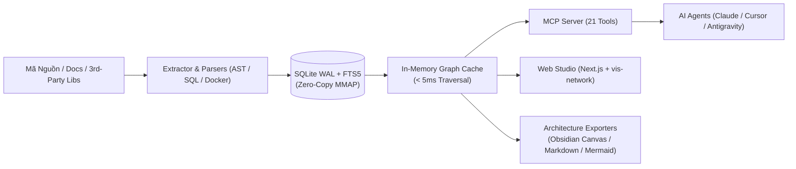

# 🧠 Neural Knowledge Base MCP Server & Studio

> **Local Neural Knowledge Graph & Architecture Intelligence Platform for AI Coding Agents**  
> Giải pháp đồ thị tri thức ngữ nghĩa cục bộ cho AI Coding Agents (*Claude, Cursor, Antigravity, Windsurf, Cline*). Giúp Agent thấu hiểu toàn bộ kiến trúc dự án, tra cứu mã nguồn và phân tích tác động thay đổi với **tốc độ < 5ms**, **tiết kiệm 90% – 95% token context**, và **hoàn toàn không ảo giác**.

---

## ⚡ Bắt Đầu Nhanh (Quick Start trong 3 Phút)

### 1. Yêu cầu hệ thống
* **Node.js**: >= 18.0.0
* **Hệ điều hành**: macOS, Linux hoặc Windows (WSL2 khuyến nghị)

### 2. Cài đặt & Build
```bash
# Clone repository
git clone https://github.com/phuongvudev/knowledge_base.git
cd knowledge_base

# Cài đặt dependencies (bao gồm cả Next.js Web Studio)
npm install

# Build cả MCP Server và Web UI
npm run build
```

### 3. Chạy Thử Nghiệm

#### Cách A: Khởi động Giao diện Web Studio (Khuyến nghị để trải nghiệm trực quan)
```bash
npm run web
```
* 🌐 **Web Studio UI**: [http://localhost:3000](http://localhost:3000)
* 🔌 **REST API Backend**: [http://localhost:4242](http://localhost:4242)

#### Cách B: Chạy File Watcher tự động đồng bộ khi viết code
```bash
# Tự động đồng bộ đồ thị tri thức mỗi khi lưu file trong dự án
npm run watch -- <project_id> <đường_dẫn_tới_thư_mục_code>

# Ví dụ:
npm run watch -- my-app /Users/name/projects/my-app
```

#### Cách C: Chạy Selftest kiểm tra toàn bộ 32 kịch bản tự động
```bash
npm run test
```

---

## 🌟 7 Tính Năng Nổi Bật (Key Highlights)



### 1. ⚡ Zero-Blind-Search Protocol (Tiết kiệm 95% Token)
* Thay vì để Agent chạy `grep`, `find`, hoặc đọc mù quáng cả ngàn dòng file, Agent sử dụng `kb_search` kết hợp **FTS5 + BM25 ranking + Multi-layer Fallback** để tìm đúng vị trí `file_path:line` kèm 12 dòng code trọng tâm trong chưa đầy **500 tokens**.

### 2. 🕸️ 360° Call Graph & Phân Tích Tác Động (`kb_graph_impact`)
* Khi chuẩn bị refactor một Entity, Service hay sửa đổi kiểu dữ liệu, `kb_graph_impact` duyệt ngược toàn bộ đồ thị để tìm tất cả các module, màn hình UI và bài test bị ảnh hưởng. **Ngăn chặn 100% regression bug trước khi gõ phím.**

### 3. 🩺 Giám Sát Sức Khỏe Kiến Trúc (`kb_audit_architecture`)
* Tự động phát hiện **Circular Dependencies (Phụ thuộc vòng lặp A → B → C → A)**.
* Phát hiện **Dead / Orphan Code** (các component, service không có ai gọi tới).
* Chấm điểm **Health Score (0 – 100)** cho kiến trúc tổng thể.

### 4. 🎨 Xuất Báo Cáo Kiến Trúc Đa Định Dạng (Exporters)
* **Obsidian Canvas (`.canvas`)**: Xuất đồ thị kiến trúc dạng trực quan để mở trực tiếp trong Obsidian.
* **Markdown Architecture Report (`.md`)**: Xuất tài liệu tổng quan hệ thống, danh sách module, hubs huyết mạch và bảng rủi ro.
* **Mermaid Graph**: Tự động render sơ đồ liên kết vĩ mô theo phân tầng.

### 5. 📦 Từ Điển Domain Động Theo Từng Dự Án (Project-Scoped Adaptive Lexicon)
* Mỗi dự án có một không gian từ điển riêng (`project_lexicon`), **hoàn toàn không ô nhiễm chéo**.
* Tự động nạp cấu hình từ file `.kb/lexicon.json` trong thư mục dự án (ví dụ từ viết tắt hoặc thuật ngữ nghiệp vụ đặc thù: Fintech, E-commerce, Y tế, DevOps).

### 6. 👁️ Neural Knowledge Studio (Web UI 60fps)
* Giao diện trực quan hóa mạng nơ-ron bằng **vis-network**, hỗ trợ **LOD (Level of Detail)** giúp render mượt mà ngay cả với các dự án lớn (>3.500 nodes).
* Tự động đóng băng mô phỏng vật lý (physics auto-freeze) khi ổn định để tiết kiệm 100% CPU nền.

### 7. 📚 Tự Động Định Vị Thư Viện Bên Thứ 3 (`kb_resolve_library`)
* Tự động soi `pubspec.lock` hoặc `package.json` để định vị mã nguồn thư viện trong `.pub-cache` hoặc `node_modules`, nạp vào graph riêng và liên kết chéo mà không cần tra cứu web.

---

## 🔌 Cấu Hình Tích Hợp AI Clients (MCP Setup)

### 1. Cursor IDE
Mở **Settings** $\rightarrow$ **Features** $\rightarrow$ **MCP Servers** $\rightarrow$ **+ Add New MCP Server**:
* **Name**: `knowledge-base`
* **Type**: `command`
* **Command**: `node /absolute/path/to/knowledge_base/dist/index.js`

### 2. Claude Desktop
Mở file `claude_desktop_config.json` (`~/Library/Application Support/Claude/claude_desktop_config.json` trên Mac hoặc `%APPDATA%\Claude\claude_desktop_config.json` trên Windows):
```json
{
  "mcpServers": {
    "knowledge-base": {
      "command": "node",
      "args": [
        "/Volumes/Data/station/personal/projects/knowledge_base/dist/index.js"
      ],
      "env": {
        "KB_DB_PATH": "/Volumes/Data/station/personal/projects/knowledge_base/data/neural_knowledge.db"
      }
    }
  }
}
```

### 3. Google Antigravity / Windsurf / Cline / Roo Code
Thêm vào file cấu hình MCP của client:
```json
{
  "mcpServers": {
    "knowledge-base": {
      "command": "node",
      "args": ["/Volumes/Data/station/personal/projects/knowledge_base/dist/index.js"],
      "disabled": false,
      "autoApprove": [
        "kb_graph_overview",
        "kb_graph_explore",
        "kb_graph_impact",
        "kb_search",
        "kb_node_get",
        "kb_file_outline",
        "kb_audit_architecture"
      ]
    }
  }
}
```

### 4. GitHub Copilot (VS Code & JetBrains / Android Studio)
Chạy lệnh cài đặt tự động (cấu hình đồng thời cả `mcp.json` và `copilot-instructions.md` cho VS Code + JetBrains IDE):
```bash
npm run install:github_copilot
```
Hoặc thêm thủ công vào `~/Library/Application Support/Code/User/mcp.json` (VS Code) hoặc `~/.config/github-copilot/intellij/mcp.json` (JetBrains / Android Studio):
```json
{
  "servers": {
    "knowledge-base": {
      "type": "stdio",
      "command": "node",
      "args": ["/Volumes/Data/station/personal/projects/knowledge_base/dist/index.js"],
      "env": {
        "KB_DB_PATH": "/Volumes/Data/station/personal/projects/knowledge_base/data/neural_knowledge.db"
      }
    }
  }
}
```

> [!TIP]
> **Chế độ siêu tiết kiệm Token Khai Báo (`KB_TOOLSET=read`)**:  
> Nếu bạn muốn tiết kiệm token hệ thống gửi mỗi lượt chat, hãy đặt biến môi trường `KB_TOOLSET=read`. Server sẽ chỉ expose 11 công cụ đọc cốt lõi (~700 tokens thay vì ~2.200 tokens).

---

## 🧰 Bảng Tra Cứu 21 Công Cụ MCP (Cheat Sheet)

| Nhóm | Tên Công Cụ | Tham Số Chính | Mô Tả Tác Dụng |
| :--- | :--- | :--- | :--- |
| **Khám phá** | `kb_graph_overview` | `project_id`, `lod (0/1)` | Xuất sơ đồ Mermaid hoặc tóm tắt các Hubs vĩ mô cấp hệ thống. |
| | `kb_graph_explore` | `node_id`, `depth (1/2)` | Khám phá mạng lưới neuron 360° quanh 1 node (inbound & outbound). |
| | `kb_node_get` | `node_id`, `include_raw` | Chi tiết node kèm quan hệ 360° và khung 30 dòng code nguyên văn. |
| **An toàn & Sức khỏe** | `kb_graph_impact` | `target_node_id` | Phân tích tác động dây chuyền (Blast Radius) khi sửa/xoá 1 symbol. |
| | `kb_audit_architecture` | `project_id` | **MỚI**: Quét circular dependencies, mã chết (orphan code), tính điểm sức khỏe. |
| | `kb_audit_gaps` | `project_id` | Rà soát liên kết gãy hoặc tài liệu bị thiếu trong đồ thị. |
| **Tra cứu** | `kb_search` | `query`, `project_id`, `code` | Tìm kiếm BM25 đa tầng (AST + Raw Source Fallback). |
| | `kb_file_outline` | `file_path`, `project_id` | Xem danh mục class, method và số dòng của 1 file lớn (<100 tokens). |
| **Nạp & Đồng bộ** | `kb_batch_ingest_directory` | `project_id`, `dir_path` | Quét nạp cả thư mục với SHA-256 delta skipping. |
| | `kb_ingest_file` | `project_id`, `file_path` | Nạp 1 file đơn lẻ (Code, PDF, Word, Markdown, SQL DDL). |
| | `kb_sync` | `project_id`, `dir_path` | Cập nhật file sửa đổi, dọn file đã xoá, nạp `.kb/lexicon.json`. |
| **Thư viện 3rd** | `kb_resolve_library` | `project_id`, `library_name` | Tự tìm `.pub-cache`/`node_modules`, nạp và bắc cầu liên kết. |
| | `kb_prune_libraries` | `dry_run`, `vacuum` | Dọn dẹp thư viện mồ côi và chạy SQLite VACUUM thu hồi đĩa. |
| **Quản trị & Tự học**| `kb_project_create` | `project_id`, `name` | Khởi tạo không gian dự án mới. |
| | `kb_project_list` | *(không)* | Liệt kê tất cả dự án, số lượng node/edge. |
| | `kb_add_node` | `project_id`, `id`, `label` | Agent tự ghi nhớ quy tắc kỹ thuật hoặc quyết định kiến trúc mới. |
| | `kb_add_relation` | `source_id`, `target_id` | Tạo quan hệ giữa 2 node bất kỳ. |
| | `kb_flag_gap` | `project_id`, `missing_item` | Đánh dấu chỗ khuyết tài liệu cần bổ sung. |
| | `kb_classify_document` | `file_path` | Phân loại tự động tài liệu (kiến trúc, nghiệp vụ, API, v.v.). |
| | `kb_stats` | `project_id` | Thống kê số lượng node, edge, top 5 Hubs quan trọng. |
| | `kb_metrics` | `reset` | Đo lường độ trễ SLA (P50/P95), % token tiết kiệm và RAM sử dụng. |

---

## 📊 Benchmark Thực Tế & Hiệu Năng (ROI)

Đo lường trực tiếp trên dự án thực tế **`budgetable-v2`** (*Flutter Melos Monorepo, 3.694 Nodes, 5.714 Edges*):

| Tiêu Chí Đánh Giá | Không Dùng KB (Grep / Đọc File Thô) | Dùng Neural Knowledge Base MCP | Mức Độ Tiết Kiệm |
| :--- | :--- | :--- | :--- |
| **Onboarding hiểu cấu trúc** | ~50.000 tokens (đọc hàng chục file) | **~250 tokens** (`kb_graph_overview`) | **Tiết kiệm 99.5%** |
| **Định vị & đọc hàm xử lý** | ~120.000 tokens (grep + mở nhiều file) | **~800 tokens** (`kb_search code=12`) | **Tiết kiệm 99.3%** |
| **Phân tích tác động dây chuyền** | ~269.000 tokens (trace thủ công 269 files)| **~13.000 tokens** (`kb_graph_impact`) | **Tiết kiệm 95.2%** |
| **Tổng Token cả phiên làm việc** | **388.070 tokens** | **18.815 tokens** | **Tiết kiệm 95.2% chi phí** |
| **Độ trễ truy vấn P50** | Vài chục giây (Disk I/O) | **3.97 miligiây** (RAM Cache) | **Nhanh hơn 1000x** |
| **Mức chiếm dụng RAM** | Lớn (đọc file vào buffer) | **~30 MB** | Cực kỳ nhẹ |

---

## 📁 Cấu Trúc Dự Án

```
knowledge_base/
├── src/
│   ├── index.ts                 # Điểm khởi chạy MCP Server (stdio protocol)
│   ├── database.ts              # SQLite WAL + FTS5 Full-Text Search Schema
│   ├── types.ts                 # TypeScript interfaces, Zod schemas
│   ├── engine/
│   │   ├── graph_memory.ts      # Zero-copy in-memory graph cache (<5ms)
│   │   ├── pagerank.ts          # Thuật toán PageRank & Centrality xác định Hubs
│   │   ├── diagnostics.ts       # Architecture Health: Circular deps & Dead code
│   │   ├── visualizer.ts        # Obsidian Canvas, Markdown Report, Mermaid exporters
│   │   ├── watcher.ts           # Real-time File System Watcher
│   │   ├── deps.ts              # Quản lý 3rd-party dependencies (.pub-cache / node_modules)
│   │   └── parsers/             # AST Parsers: Dart, TypeScript, Python, SQL DDL, Docker
│   ├── tools/                   # Bộ 21 công cụ MCP (Query, Ingestion)
│   └── server/
│       └── http.ts              # REST API Server phục vụ Web Studio (port 4242)
├── web/                         # Neural Knowledge Studio (Next.js 16 + Tailwind)
│   └── src/components/
│       ├── GraphCanvas.tsx      # Sơ đồ tương tác vis-network với LOD & auto-freeze
│       └── ArchitectureHealth.tsx # Tab chẩn đoán sức khỏe kiến trúc
└── data/                        # File cơ sở dữ liệu neural_knowledge.db (WAL mode)
```

---

## 📄 Bản Quyền & Giấy Phép
Dự án được thiết kế theo nguyên tắc **100% Local-First**. Mọi dữ liệu mã nguồn, tài liệu và sơ đồ tri thức đều được lưu trữ và xử lý hoàn toàn cục bộ trên máy tính của bạn, không gửi bất kỳ dữ liệu nào ra máy chủ bên ngoài.
